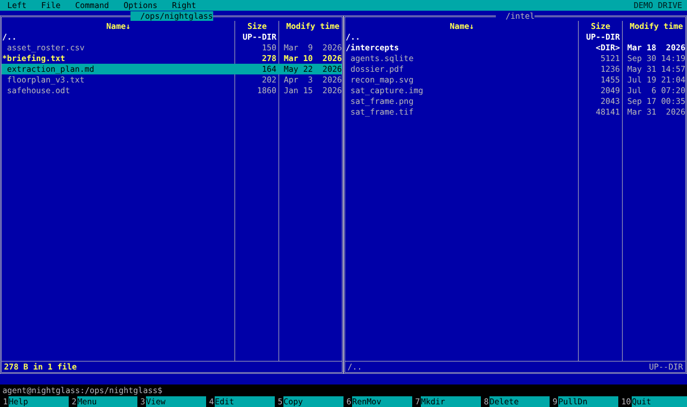
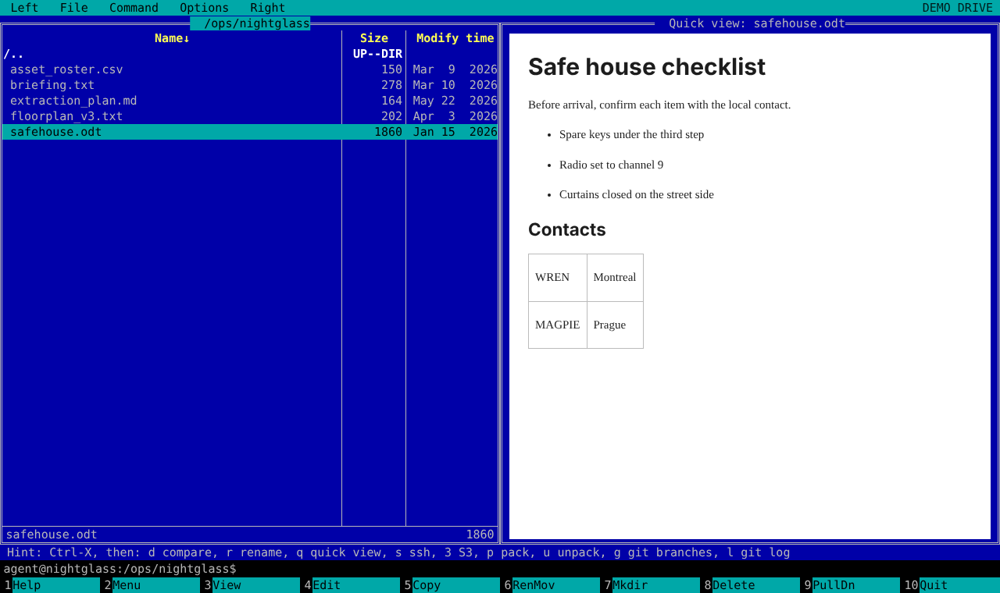
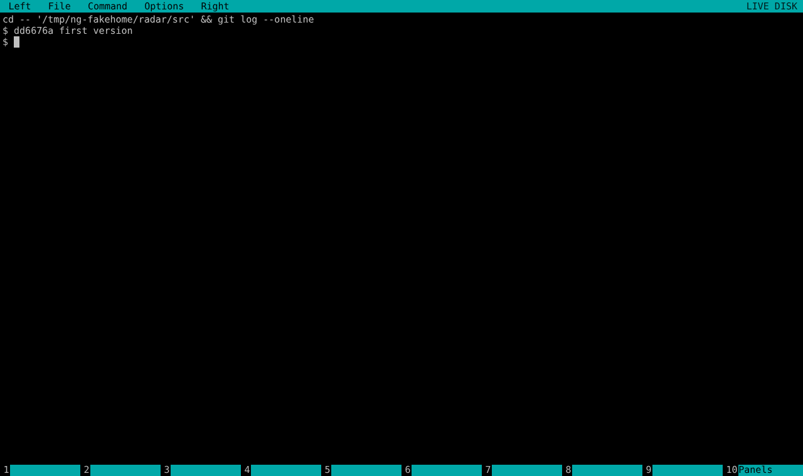
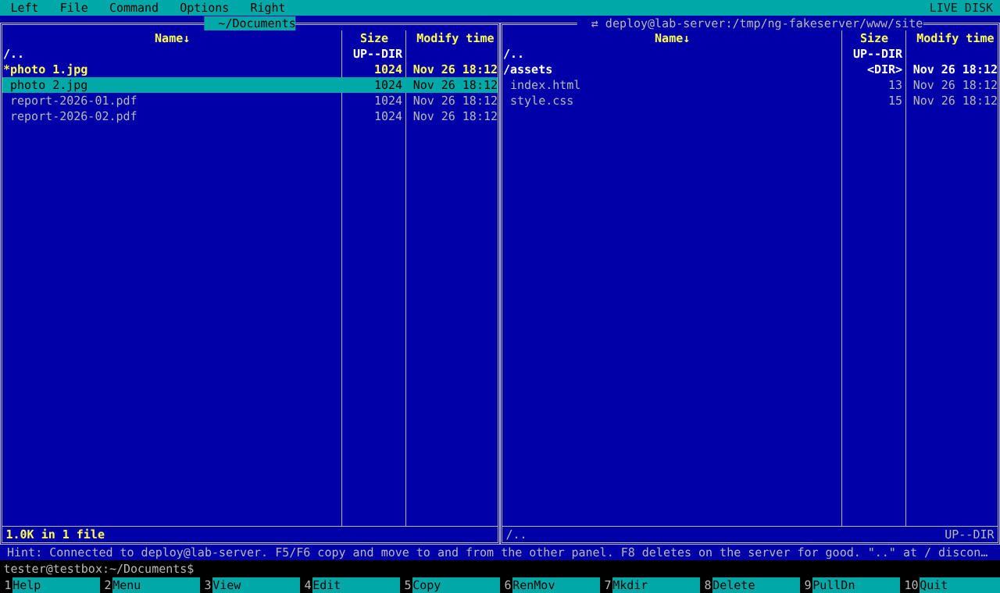
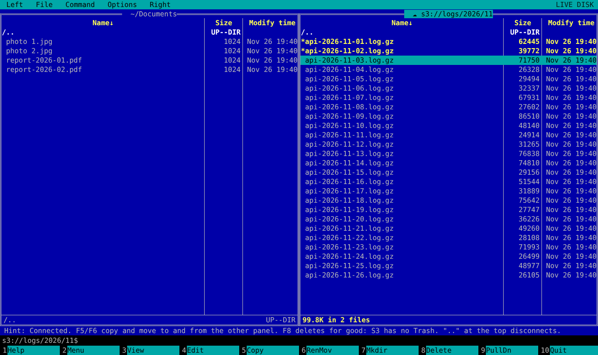
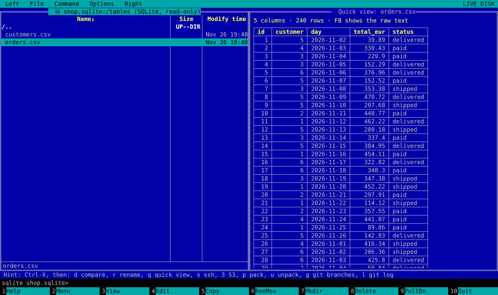
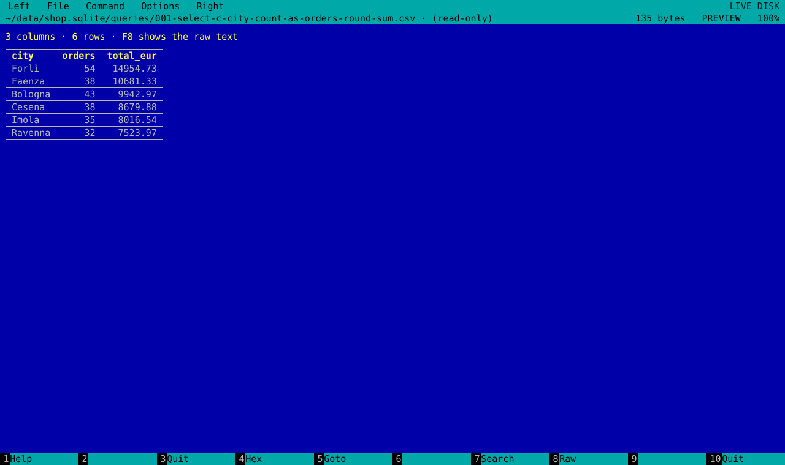
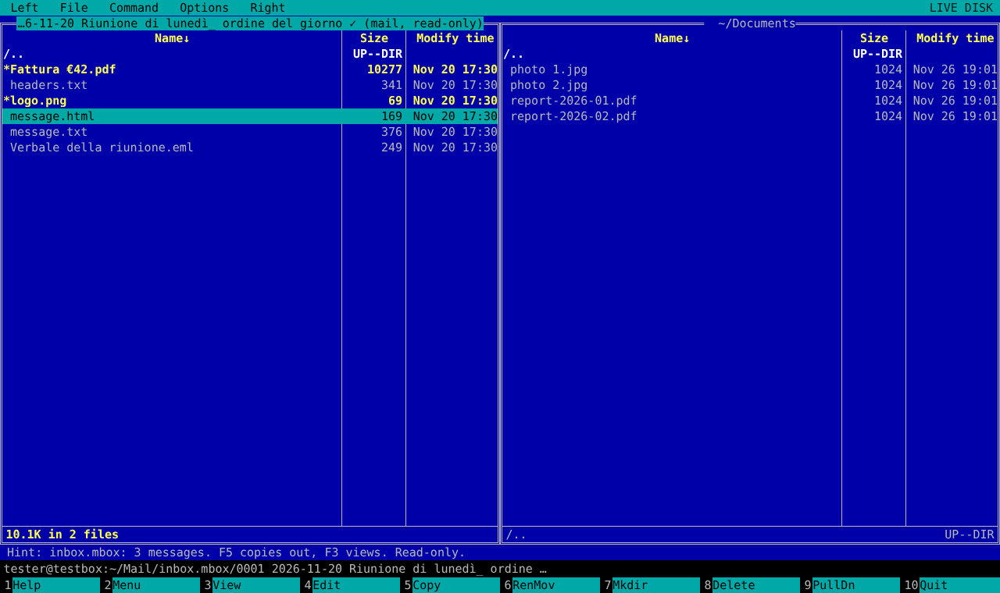
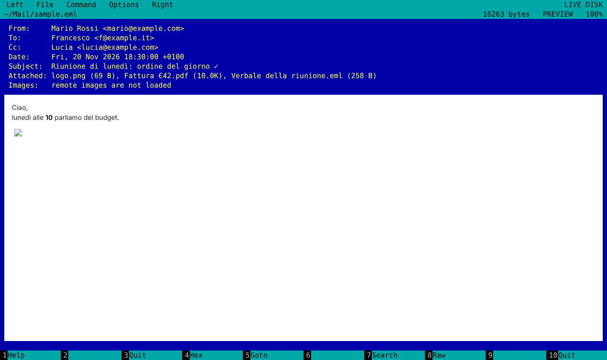
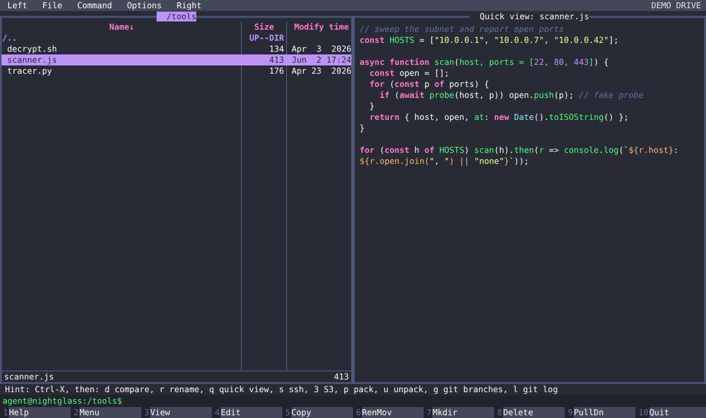

# Nightglass File System

A two-panel file manager modelled on Midnight Commander. It runs as a [Claude](https://claude.ai) artifact and installs as a desktop app from the Claude desktop app. In a browser it works on a demo drive with made-up files; installed as an app it works on the real files of your computer, with Git, a real terminal, SSH servers and S3 buckets. It also opens mail files and SQLite databases as folders.



- [Install it on your own Claude account](#install-it-on-your-own-claude-account)
- [Features](#features)
- [How the code is organised](#how-the-code-is-organised)
- [Running it locally and testing](#running-it-locally-and-testing)
- [License](#license)

## Install it on your own Claude account

Nightglass can read, write and delete files and run commands on your computer. Claude only grants that access to an app that belongs to **your** account and that nobody else has written to. So you cannot use someone else's copy on your disk: you publish your own copy from this repository, and install that. It takes about five minutes.

### What you need

- A Claude account, signed in to the **Claude desktop app** on macOS or Windows.
- A Claude conversation that can create artifacts (published pages). If Claude answers that it cannot publish artifacts, check that artifacts are turned on in your Claude settings.
- For Git, `git` installed on your computer. For SSH, the `ssh` command (built into macOS, Linux and recent Windows) and your SSH keys. For S3, the AWS CLI (`aws`) with your keys in `~/.aws`. For SQLite, the `sqlite3` command if you have it (built into macOS and most Linux); without it a built-in engine is used, for databases up to 256 MB.

### Steps

1. **Download the code.** On this page click **Code › Download ZIP** and unzip it. You get a folder called `nightglass-main`.

2. **Give the folder to Claude.** In the Claude desktop app, start a new conversation, click **+** and choose **Add folder**, then pick the `nightglass-main` folder.

3. **Ask Claude to publish it.** Send this message:

   > Publish this folder as my own artifact by following the instructions in its CLAUDE.md file.

   Claude reads [`CLAUDE.md`](CLAUDE.md), publishes `index.html` with the `vendor/` and `icons/` folders, and turns on the app permissions. A card with your new artifact appears in the conversation. Nothing is sent to anyone else: the artifact is private to you.

4. **Install it as an app.** Open the artifact in the Claude desktop app (not in a web browser). In the hint line at the bottom, click **Install as app**, and confirm.

5. **Open it and grant access.** Open **Nightglass** from the Dock (macOS) or the Start menu (Windows). In the hint line, click **Grant full access**, and confirm in the dialog. The top right corner switches from `DEMO DRIVE` to `LIVE DISK`: you are now on your real files, starting from your home folder.

6. **Read the manual.** Press **F1** inside the app. The manual is in Italian; the interface and key names are in English.

### Before you grant access

"Full access" lets the app read, change and delete your files and run commands, without asking again. The whole app is the single file `index.html` in this repository (plus well-known libraries in `vendor/`), so you can read what it does before you install it. Inside the app, **F8** moves files to the system Trash instead of deleting them, except on SSH servers, which have no Trash.

### Updating

Claude asks for full access again every time a new version is published. To update:

1. download the new ZIP from this repository and unzip it over the old folder;
2. in Claude, add the folder again and send: *"Update my Nightglass artifact from this folder by following CLAUDE.md."* Keep the same artifact rather than creating a new one, so the installed app keeps its place;
3. open Nightglass and grant full access again.

### Just trying it

Open `index.html` from the downloaded folder in any web browser. It runs on the demo drive: the panels, viewer, editor, archives and console work, but not the real disk, Git, the terminal or SSH.

### If something goes wrong

| Problem | What to do |
|---|---|
| No **Install as app** button | Open the artifact in the Claude desktop app, not in a web browser. |
| **Grant full access** never appears, or says it is not available | Make sure you are using your own copy, published from your own account, and that nobody else edited it. |
| Stays on `DEMO DRIVE` after granting access | Quit Nightglass and open it again from the Dock or Start menu. |
| SSH says "Permission denied" | Use **Login in terminal** in the Shell link dialog (Ctrl-X s) to type the password or accept the server key once. |
| Git features missing | Install `git` and make sure it works in a terminal. |

## Features

| | |
|---|---|
|  |  |
| **F3 viewer**: text with syntax highlighting for about 35 languages. | **Previews**: images (TIFF too), PDF, DOCX, ODT/ODS/ODP, audio and video. |
|  |  |
| **F4 editor**: F2 saves; CRLF line endings and BOM are kept. | **Hex editor** (F3 › F4 › F2): changed bytes in red, F6 saves, F7 searches bytes. |
|  |  |
| **Quick view** (Ctrl-X q): the other panel previews the file under the cursor. | **Batch rename** (Ctrl-X r): regex, counters, dates, live preview with conflicts, undo. |
|  |  |
| **Console** (demo drive): ls, cat, grep, find, tree, du, tar, with `>` and `>>`. | **Archives**: Enter opens tar/tgz/zip, F5 extracts, Ctrl-X p packs, Ctrl-X u unpacks. |
|  |  |
| **Git** (Ctrl-X g): current branch in the title, file status (M, ?), branch list. | **Browse a branch** read-only without checking it out; the working tree on the right. |
|  |  |
| **Terminal** (Ctrl-O, desktop app): your real shell in the panel's folder. | **Manual** (F1, in Italian): contents, links, search, opens on the right page. |
|  | |
| **Remote servers** (Ctrl-X s, desktop app): a panel on a server over SSH; F5/F6 copy and move between your disk and the server, F4 edits on the server. | |
|  |  |
| **S3 buckets** (Ctrl-X 3, desktop app): `s3://logs/2026/11/` on AWS, or on MinIO, Ceph, Garage, R2, Wasabi with a profile and an endpoint URL. Read and write like SSH. Only one level is listed, 1000 entries at a time, so a bucket of millions of objects opens as fast as a small one. | **SQLite**: Enter opens a database as a read-only folder: `schema.sql`, `tables/*.csv`, `views/*.csv`. F3 and Quick view show CSV files as a grid; F5 exports a table. |
|  | |
| **SQL queries**: inside a database the command line talks to SQLite (`sqlite shop.sqlite>`). The result opens as a grid and is kept in `queries/`. Uses the system `sqlite3` when present, otherwise sql.js (WebAssembly). | |
|  |  |
| **Mail files**: Enter opens an `.eml`, an `.mbox` (one folder per message) or an Outlook `.msg` as a read-only folder of the text, the HTML and the attachments; F5 copies attachments out, Ctrl-X u extracts everything. | **Mail preview** (F3): headers and the formatted message. Remote images and scripts are never loaded, so opening a message does not tell the sender you read it. |

**Skins**: 12 colour schemes, which also apply to code and the terminal (the animation at the top shows all of them). Dracula, Eclipse and Neon:

| | | |
|---|---|---|
|  |  |  |


**Phone**: one panel at a time, function keys on two rows, a Tab key to switch panel.

Key names follow Midnight Commander, written out in full: `Ctrl-X q` means press Ctrl+X, release, then press q.

<br clear="right">

## How the code is organised

```
index.html          the whole app: HTML, CSS and JavaScript in one file
vendor/             third-party libraries, loaded on demand (see THIRD_PARTY.md)
icons/              app icon (icon.svg is the source, the PNGs are generated)
CLAUDE.md           instructions Claude follows to publish, install and change the app
tests/harness.py    fake Claude desktop API to test LIVE DISK mode in a browser
tests/fakebin/ssh   fake ssh that runs "remote" commands in a local folder
tests/fakebin/aws   fake aws CLI: the S3 commands the app uses, on a local folder
tests/smoke.py      Playwright smoke test
tests/mailfixtures.py sample .eml, .mbox and Outlook .msg files for the tests
docs/screenshots.py regenerates the screenshots in docs/screenshots/
```

There is no build step: edit `index.html` and reload.

The script is one `{ … }` block split into sections marked with `/* ---------- name ---------- */` comments, in this order:

| Section | What it holds |
|---|---|
| paths | paths always use `/`, on Windows too (`C:/Users/…`) |
| demo backend | `Demo`: a virtual drive kept in `localStorage` and, when available, in the artifact's database (`db`, one document per user) |
| live backend | `Live`: the real disk through `claude.use('desktop')` (fs, shell, os) |
| state / panels | the two panels `P[0]` and `P[1]`, rendering, `cd`, `reload` |
| file operations | recursive copy, move, mkdir, delete |
| previews | images, TIFF (UTIF), PDF (pdf.js), DOCX (mammoth), ODF (JSZip), audio and video |
| viewer | F3, a virtualised hex dump and the hex editor |
| syntax highlighting | highlight.js, coloured from the current skin |
| quick view | preview in the other panel |
| archives | tar reader and writer, gzip through `CompressionStream`, zip through JSZip, virtual filesystem `arcFS` |
| mail | MIME parser on bytes (RFC 2047/2231 names, base64, quoted-printable, any charset `TextDecoder` knows), mbox splitter (mboxrd), OLE compound file and MAPI reader for `.msg` with compressed RTF; each message laid out as files for `arcFS`, mbox messages parsed only when opened |
| sqlite | engines `sqlCli` (system `sqlite3 -readonly`) and `sqlJs` (sql.js, in memory, `PRAGMA query_only`); `openSqlite` lays a database out as files for `arcFS`; `runSql` for the command line; `csvTable` previews CSV |
| ssh | `sshFS`: a remote server through the system `ssh` client; virtual paths `/@ssh/<target>/…` |
| s3 | `s3FS`: buckets through the system `aws` CLI; virtual paths `/@s3/<connection>/<bucket>/<key>`, connections (profile, endpoint) in `prefs.s3c`; paged listing with a "more" row |
| git | `git` through `childProcess.exec`, file status, virtual filesystem `gitFS` to browse a branch |
| editor | F4, a textarea with a highlighted overlay |
| manual | the F1 manual, content in `MAN` (Italian) |
| menus, dialogs, command line, console, keyboard, mouse | user interface |
| skins | 12 colour schemes as lists of CSS variables (`SKINS`, `SYN`) |
| subshell | real terminal (xterm.js + `desktop.pty`) |
| compare, batch rename | Ctrl-X d, Ctrl-X r |
| desktop app | install, full-access permission, switch to LIVE DISK |

The key function is `FS(p)`: it returns the right backend for a panel. That is the disk (`Demo` or `Live`), an open archive, mail file or SQLite database (`arcFS`, which can be nested: a zip in a zip, an .eml in an .mbox), a browsed Git branch (`gitFS`), an SSH server (`sshFS`) or an S3 connection (`s3FS`). `fsAt(path)` does the same for a destination path. All of them provide `list`, `stat`, `exists` and `readBytes`; `Demo`, `Live`, `sshFS` and `s3FS` can also write. Every write goes through `roGuard()` first.

`mode` says what is in front: `panels`, `view`, `edit`, `con` (demo console), `term` (terminal), `man` (manual). One keyboard listener handles everything, in this order: dialogs, manual, terminal, function keys, console, menus, viewer/editor, panels.

### Artifact capabilities

The artifact declares the `db`, `user` and `desktop` capabilities. The desktop permissions are in the `<script id="claude-artifacts-manifest">` tag at the top of `index.html`: only `"full-access"`, which covers fs, shell, terminal, Git and SSH. See [`CLAUDE.md`](CLAUDE.md) for how they are set when publishing.

### Rules for changes

- Values that come from the disk (file names, contents, git and ssh output) never go into HTML without `esc()`. DOCX and ODT documents render in an `iframe` with `sandbox=""`; HTML mail renders the same way, plus a Content-Security-Policy that allows only `data:` images.
- Deleting on the real disk means `shell.trashItem`, never `fs.rm` (the one exception: undoing an empty file the app just created).
- Libraries in `vendor/` load only when needed, through `lib(src, global)`.
- Keep Midnight Commander's keys where they exist; new ones go under `Ctrl-X <letter>`. Write keys out in full in the interface (`Ctrl-X`, `Alt-I`, `Shift-F4`), not in MC's `C-x` notation.
- Every new feature also goes into the manual (`MAN`) and, if it has a key, into its "Tutte le scorciatoie" section.
- Run `python3 tests/smoke.py` before publishing.

## Running it locally and testing

Demo mode: open `index.html` in a browser (from `file://` too), or serve the folder with `python3 -m http.server` and open `http://localhost:8000`. Outside Claude, `claude.use` does not exist, so the app stays on the demo drive and does not sync.

LIVE DISK mode without the Claude desktop app: `tests/harness.py` injects a fake desktop API that works on a real folder (`/tmp/ng-fakehome`, change it with `NG_FAKE_HOME`). The Trash goes to `/tmp/ng-faketrash`; `git` and the shell are your machine's. `tests/fakebin/ssh` stands in for `ssh` and runs the "remote" commands in `/tmp/ng-fakeserver`; `tests/fakebin/aws` stands in for the AWS CLI, with buckets as folders of `/tmp/ng-fakes3` (`NG_FAKE_S3`). SQLite tests use your `sqlite3` command, and the sql.js engine through a local HTTP server (WebAssembly does not load from `file://`).

```
pip install playwright && playwright install chromium
pip install compressed_rtf extract_msg   # compressed_rtf builds the sample .msg; extract_msg (optional) double-checks it
python3 tests/smoke.py
python3 docs/screenshots.py
```

The smoke test builds the fake folder with a small Git repository, then checks the demo drive, console, `tar`, PDF preview, manual, LIVE DISK mode, app icon, Git status, browsing a branch, an SSH connection and an upload, and the mail reader: attachments copied out of an .eml and a .msg byte for byte, an .mbox with a latin-1 base64 message, nested messages, the HTML preview with remote images blocked, and extracting a whole mailbox; S3 (download, upload, folder upload, mkdir, rename, delete, a 2500-object prefix paged by 1000, bucket list, profile and endpoint, missing credentials); SQLite (folder layout, grid preview, a 20000-row export identical to `sqlite3` output, queries, read-only refusal, a `.db` that is not SQLite, sql.js on the demo drive). If `extract_msg` is installed, the sample .msg is also read back with it as an independent check. Screenshots go to `tests/out/`.

## Open ideas

Directory hotlist (Ctrl-\\), quick search by typing (Ctrl-S), directory history, "Find file" with results in a panel, chmod and symlinks, pipes in the demo console, side-by-side diff of two files, selection with Shift+arrows, an English version of the manual, S3 presigned links and bucket creation.

## License

Copyright (C) 2026 Francesco Fullone.

Nightglass is free software: you can redistribute it and/or modify it under the terms of the GNU General Public License, version 2 or (at your option) any later version. The full text is in [`LICENSE`](LICENSE). SPDX identifier: `GPL-2.0-or-later`.

The libraries in `vendor/` keep their own licenses, listed in [`THIRD_PARTY.md`](THIRD_PARTY.md). pdf.js is under Apache-2.0, which is compatible with the GPL from version 3: that is why the license is "version 2 or later" rather than "version 2 only".
