# Nightglass File System

File manager a due pannelli sul modello di Midnight Commander, pubblicato come artifact di Claude e installabile come app desktop dal Claude desktop app. Nel browser lavora su un disco demo con file inventati; installato come app lavora sui file veri del computer.

Il manuale utente è dentro l'app (F1, in italiano). Questo file è per chi mette mano al codice.

## Funzionalità

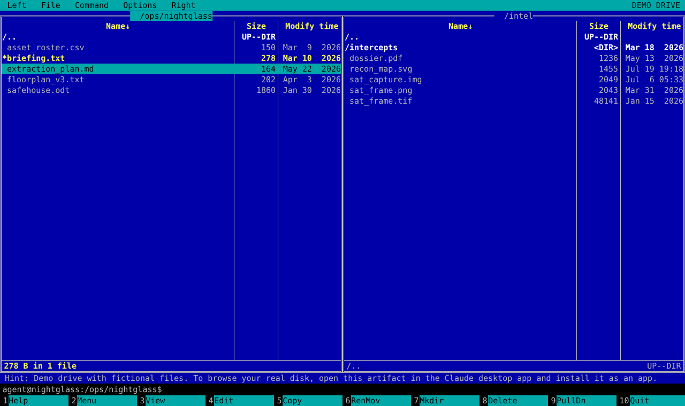

Due pannelli, barra dei menu, riga di comando e tasti F1–F10 come in MC. Tab cambia pannello, Ctrl-T o Ins marcano i file, F5/F6/F7/F8 copiano, spostano, creano cartelle e cancellano (sul disco vero F8 sposta nel Cestino).

| | |
|---|---|
| 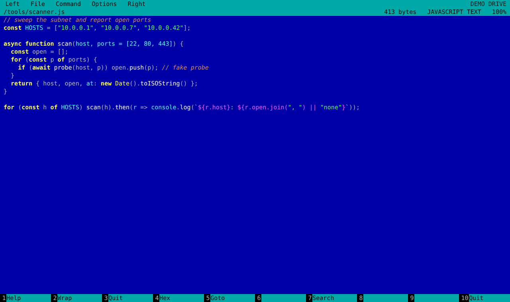 | 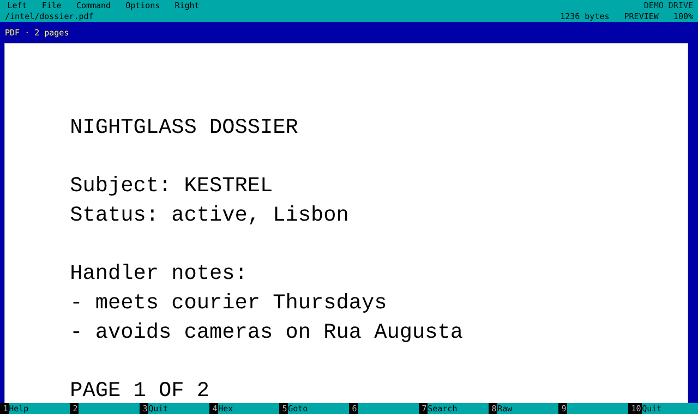 |
| **F3 visualizzatore**: testo con evidenziazione della sintassi in circa 35 linguaggi. | **Anteprime**: immagini (anche TIFF), PDF, DOCX, ODT/ODS/ODP, audio e video. |
| 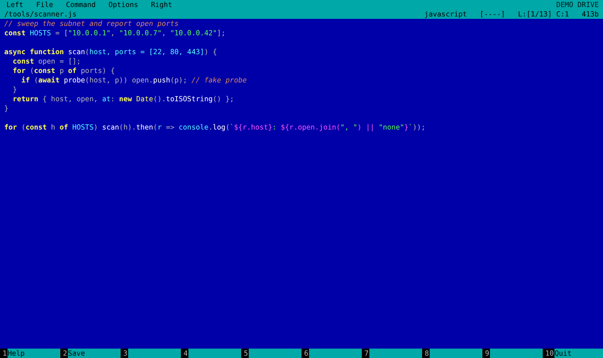 | 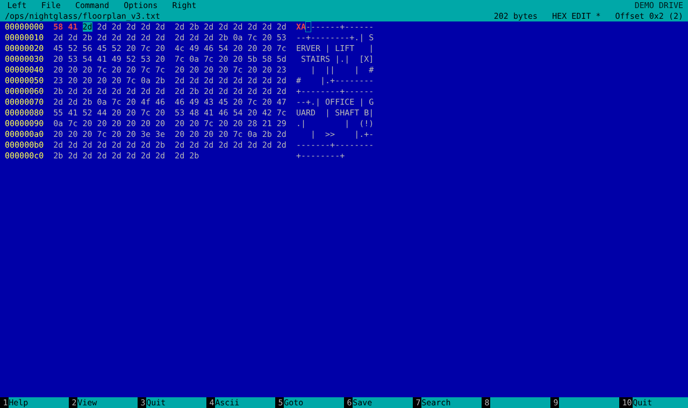 |
| **F4 editor**: salva con F2, mantiene a capo CRLF e BOM. | **Editor esadecimale** (F3 › F4 › F2): byte modificati in rosso, F6 salva, F7 cerca byte. |
|  | 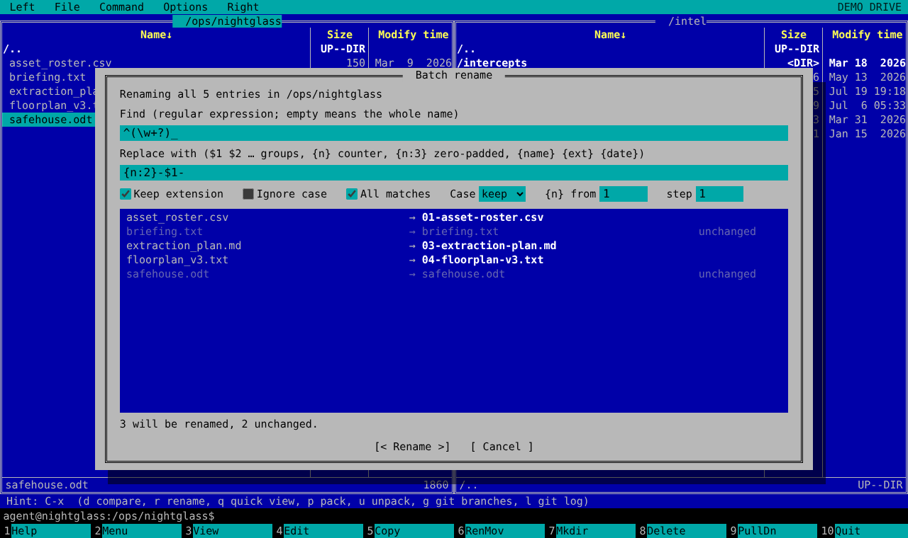 |
| **Quick view** (C-x q): l'altro pannello mostra l'anteprima del file sotto il cursore. | **Rinomina in blocco** (C-x r): regex, contatori, date, anteprima con conflitti, annullabile. |
| 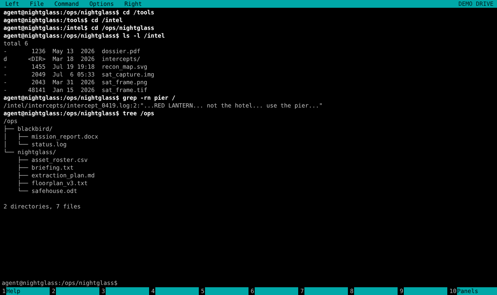 | 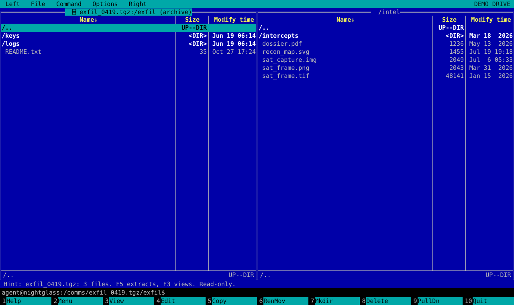 |
| **Console** (disco demo): ls, cat, grep, find, tree, du, tar, con `>` e `>>`. | **Archivi**: Invio entra in tar/tgz/zip, F5 estrae, C-x p crea, C-x u estrae tutto. |
| 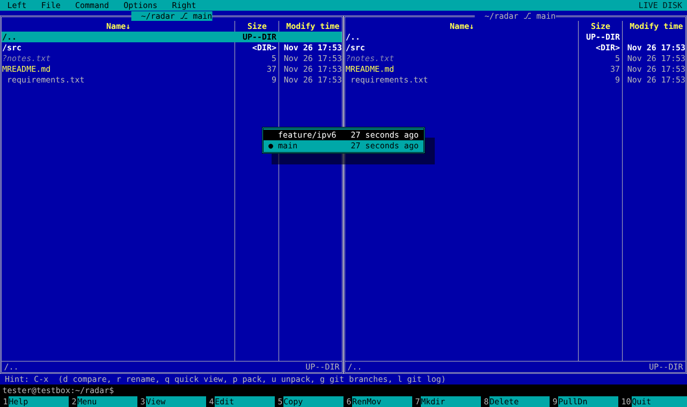 | 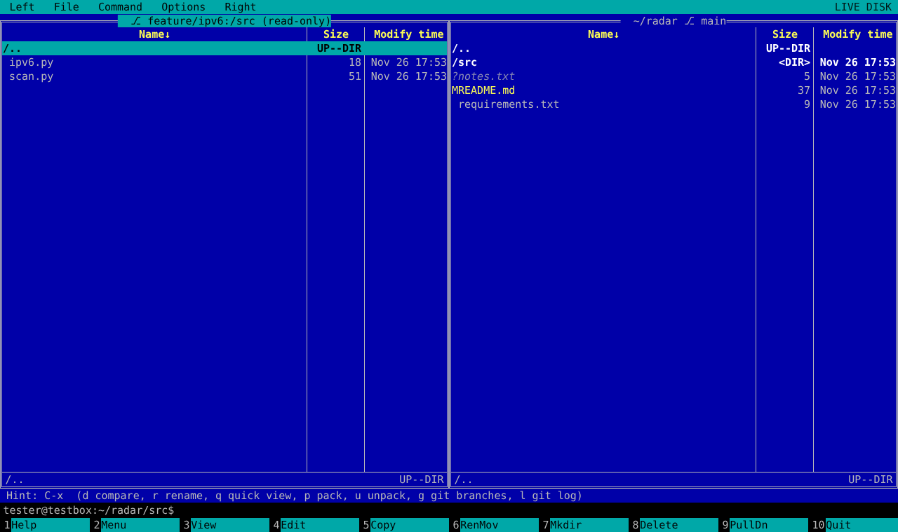 |
| **Git** (C-x g): branch attuale nel titolo, stato dei file (M, ?), elenco dei branch. | **Sfogliare un branch** in sola lettura senza checkout; a destra la copia di lavoro. |
|  | 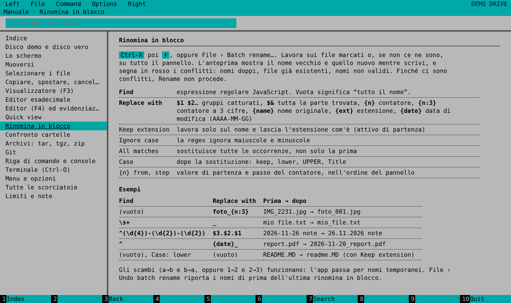 |
| **Terminale** (Ctrl-O, app desktop): la shell vera nella cartella del pannello. | **Manuale** (F1, in italiano): indice, collegamenti, ricerca, contestuale. |

**Skin**: 12 schemi colore, che valgono anche per il codice e il terminale. Qui Dracula, Eclipse e Neon:

| | | |
|---|---|---|
|  | 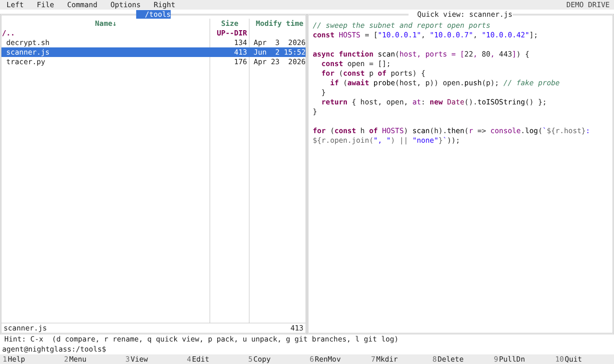 | 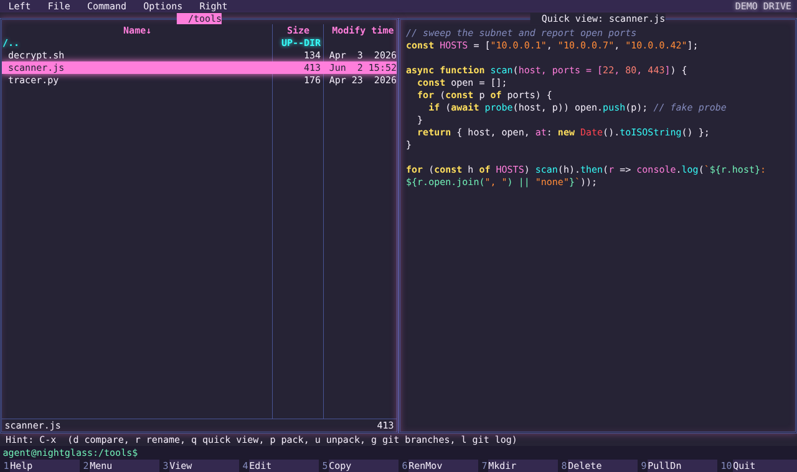 |

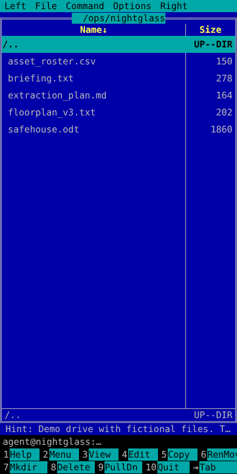

**Telefono**: un pannello alla volta, tasti funzione su due righe, Tab per passare all'altro pannello.

Gli screenshot si rigenerano con `python3 docs/screenshots.py` (stessi requisiti dei test).

<br clear="right">

## Struttura

```
index.html          tutta l'app: HTML, CSS e JavaScript in un file
vendor/             librerie di terze parti, caricate su richiesta (vedi THIRD_PARTY.md)
icons/              icona dell'app (icon.svg è il sorgente, i PNG sono generati)
tests/harness.py    finta API desktop per provare la modalità LIVE DISK nel browser
tests/smoke.py      test di fumo con Playwright
docs/screenshots.py rigenera gli screenshot del README in docs/screenshots/
```

Nessun build: si modifica `index.html` e si ricarica.

## Come gira

Lo script è un unico blocco `{ … }` diviso in sezioni marcate da commenti `/* ---------- nome ---------- */`, in quest'ordine:

| Sezione | Cosa contiene |
|---|---|
| paths | percorsi sempre con `/`, anche su Windows (`C:/Users/…`) |
| demo backend | `Demo`: disco virtuale salvato in `localStorage` e, se disponibile, nel database dell'artifact (`db`, documento per utente) |
| live backend | `Live`: disco vero tramite `claude.use('desktop')` (fs, shell, os) |
| state / panels | stato dei due pannelli `P[0]`, `P[1]`, rendering, `cd`, `reload` |
| file operations | copia ricorsiva, spostamento, mkdir, cancellazione |
| previews | anteprime: immagini, TIFF (UTIF), PDF (pdf.js), DOCX (mammoth), ODF (JSZip), audio/video |
| viewer | F3, dump esadecimale virtualizzato ed editor esadecimale |
| syntax highlighting | highlight.js con colori presi dalla skin |
| quick view | anteprima nell'altro pannello |
| archives | parser e writer tar, gzip con `CompressionStream`, zip con JSZip, filesystem virtuale `arcFS` |
| git | `git` via `childProcess.exec`, stato dei file, filesystem virtuale `gitFS` per sfogliare un branch |
| editor | F4, textarea con overlay evidenziato |
| manual | il manuale F1, contenuto in `MAN` |
| menus, dialogs, command line, console, keyboard, mouse | interfaccia |
| skins | 12 schemi colore come liste di variabili CSS (`SKINS`, `SYN`) |
| subshell | terminale vero (xterm.js + `desktop.pty`) |
| compare, batch rename | C-x d, C-x r |
| desktop app | installazione, permesso di accesso completo, passaggio a LIVE DISK |

Il punto chiave è `FS(p)`: restituisce il backend giusto per un pannello. Può essere il disco (`Demo` o `Live`), un archivio aperto (`arcFS`) o un branch Git sfogliato (`gitFS`). Tutti espongono `list`, `stat`, `exists`, `readBytes`; solo `Demo` e `Live` scrivono. Le operazioni che scrivono passano da `roGuard()`.

`mode` dice cosa è in primo piano: `panels`, `view`, `edit`, `con` (console demo), `term` (terminale), `man` (manuale). La tastiera è gestita in un solo listener, in quest'ordine: dialoghi, manuale, terminale, tasti funzione, console, menu, visualizzatore/editor, pannelli.

## Capability dell'artifact

L'artifact dichiara `db`, `user` e `desktop`. I permessi desktop sono nel tag `<script id="claude-artifacts-manifest">` in testa a `index.html`: oggi solo `"full-access"`, che serve per fs, shell, terminale e Git.

Due cose da sapere:

- Il permesso di accesso completo si richiede di nuovo a ogni nuova versione pubblicata.
- L'accesso completo funziona solo se nessuno **fuori dall'organizzazione** del proprietario ha scritto nell'artifact. Un collaboratore esterno deve lavorare su una copia, non sull'artifact originale.

## Provare in locale

Modalità demo: apri `index.html` nel browser (anche da `file://`), oppure servi la cartella con `python3 -m http.server` e apri `http://localhost:8000`. Fuori dal sito di Claude `claude.use` non esiste, quindi l'app resta sul disco demo e non sincronizza.

Modalità LIVE DISK senza il Claude desktop app: `tests/harness.py` inietta una finta API desktop che lavora su una cartella vera (`/tmp/ng-fakehome`, cambiabile con `NG_FAKE_HOME`). Il Cestino finisce in `/tmp/ng-faketrash`, e `git` e la shell sono quelli della macchina.

```
pip install playwright && playwright install chromium
python3 tests/smoke.py
```

Il test crea la cartella finta con un piccolo repository Git, prova disco demo, console, `tar`, anteprima PDF, manuale, modalità LIVE DISK, icona, stato Git e browsing di un branch. Gli screenshot vanno in `tests/out/`.

## Regole del codice

- I valori che arrivano dal disco (nomi di file, contenuti, output di git) non finiscono mai in HTML senza `esc()`. I documenti DOCX/ODT si mostrano in un `iframe` con `sandbox=""`.
- Cancellare sul disco vero significa `shell.trashItem`, mai `fs.rm` (unica eccezione: l'annulla di un file vuoto appena creato).
- Le librerie in `vendor/` si caricano solo quando servono, con `lib(src, globale)`.
- Mantieni le scorciatoie di MC quando esistono; le nuove vanno sotto `Ctrl-X <lettera>`.
- Ogni funzione nuova va anche nel manuale (`MAN`) e, se ha un tasto, nella sezione "Tutte le scorciatoie".

## Idee aperte

Hotlist delle cartelle (C-\\), ricerca rapida digitando (C-s), cronologia delle cartelle, "Find file" con risultati nel pannello, chmod/symlink, pipe nella console demo, diff affiancato fra due file, selezione con Shift+frecce.

## Licenza

Copyright (C) 2026 Francesco Fullone.

Nightglass è software libero: puoi ridistribuirlo e modificarlo secondo i termini della GNU General Public License, versione 2 o (a tua scelta) qualunque versione successiva. Il testo completo è in `LICENSE`. Identificativo SPDX: `GPL-2.0-or-later`.

Le librerie in `vendor/` mantengono le loro licenze, elencate in `THIRD_PARTY.md`. pdf.js è sotto Apache-2.0, compatibile con la GPL dalla versione 3: per questo la licenza è "versione 2 o successive" e non "solo versione 2".
